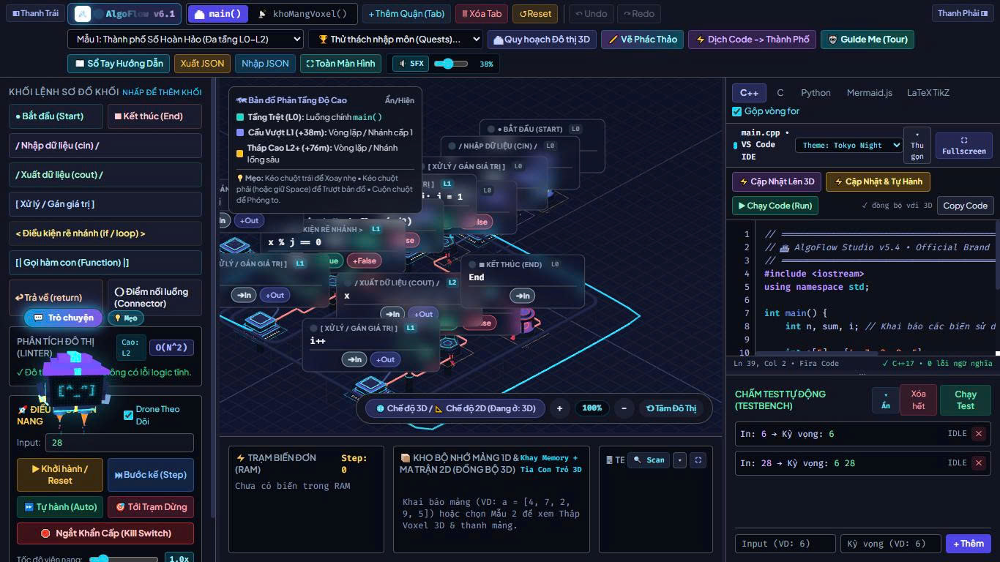

# 🏙️ AlgoFlow Studio v6.1 - The Living Algorithm City & Visual Programming Workbench

> Nền tảng học tập giải thuật trực quan biến đổi sơ đồ khối (Flowchart) thành đô thị 3D Isometric và biên dịch hai chiều sang mã nguồn C++17/C/Python chuẩn giáo dục.

[](https://algoflow-studio.vercel.app)
[](https://github.com)

---

## 📸 Giao diện ứng dụng



_Trải nghiệm trực tiếp tại:_ **[algoflow-studio.vercel.app](https://algoflow-studio.vercel.app/)**

---

## 🌟 Tính năng nổi bật

- **Đô thị Giải thuật 3D (Living Algorithm City):** Chuyển đổi các khối điều khiển tuần tự, rẽ nhánh và vòng lặp thành các công trình kiến trúc 3D phân tầng theo độ sâu lồng nhau (Elevation Layers).
- **Mô phỏng Viên nang Dữ liệu (Step-Trace Debugger):** Viên nang năng lượng di chuyển trên các tuyến đường nối (Highways) theo từng bước thực thi, đồng bộ biến đổi trực tiếp lên bảng RAM và tháp Voxel mảng 1D/2D.
- **Biên dịch Hai chiều AST (Code ⇄ Flowchart):**
  - Tự động sinh mã nguồn **C++17/C++20** chuẩn giáo dục kèm chú thích sư phạm từng dòng.
  - Hỗ trợ đa ngôn ngữ đầu ra: **C (C99/C11)**, **Python 3**, **Mermaid.js**, và **LaTeX TikZ**.
  - Trình phân tích cú pháp đệ quy (Recursive Descent AST Parser) cho phép dán code C++ để dịch ngược lại thành đô thị 3D.
- **Trợ lý Linh vật Bitto AI Copilot 2.0:** Tương tác 3D đa điểm, gợi ý phân tích độ phức tạp thời gian Big-O, hướng dẫn thử thách thuật toán và cảnh báo vòng lặp vô tận (Kill Switch).
- **Chấm Test Tự Động (Automated Testbench):** Kiểm thử thuật toán với nhiều bộ dữ liệu cùng lúc, tự động báo trạng thái `PASS`, `FAIL` hoặc `TLE`.

---

## 🛠️ Công nghệ sử dụng (Tech Stack)

- **Frontend & UI:** HTML5, Tailwind CSS, Google Fonts (Plus Jakarta Sans, Fira Code).
- **3D Graphics:** [Three.js](https://threejs.org/) (Orthographic Camera, Procedural Geometry, Lighting, OrbitControls).
- **Core Architecture:** Vanilla JavaScript (ES6+ Modular Architecture), Canvas API, SVG Overlay.
- **Deployment:** Vercel CI/CD via GitHub.

---

## 🚀 Hướng dẫn chạy cục bộ (Local Setup)

1. Tải hoặc nhân bản kho lưu trữ:
   ```bash
   git clone [https://github.com/STJ_MK08/algoflow-studio.git](https://github.com/STJ_MK08/algoflow-studio.git)
   cd algoflow-studio
   ```
